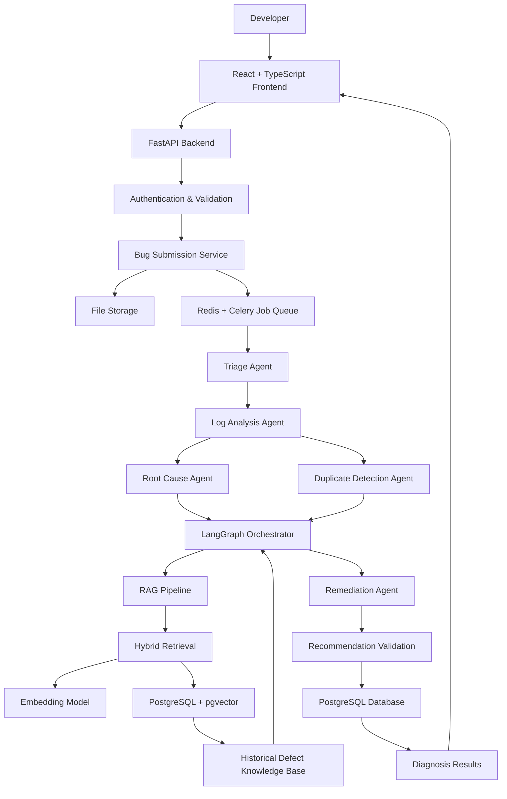
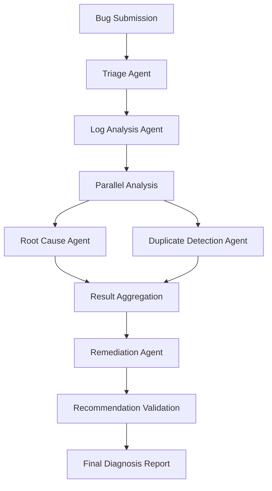
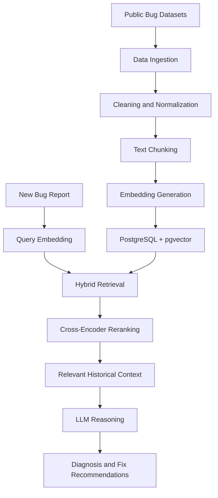

# FaultLens AI – System Architecture

## 1. Introduction

FaultLens AI is an intelligent software debugging platform designed to assist developers in identifying, analyzing, and resolving software defects.

The platform combines Artificial Intelligence, Retrieval-Augmented Generation (RAG), semantic search, vector embeddings, and multi-agent orchestration to analyze bug reports and recommend potential solutions.

Instead of relying only on traditional keyword-based debugging, FaultLens AI retrieves relevant historical defects and uses their information to generate context-aware, evidence-backed recommendations.

## 2. System Objectives

The primary objectives are:

- Analyze software bug descriptions, error logs, and stack traces.
- Identify probable root causes of software defects.
- Detect duplicate or semantically similar historical bug reports.
- Retrieve relevant solutions from historical defect repositories.
- Generate intelligent fix recommendations.
- Provide developers with an organized diagnosis report.
- Build an expandable historical defect knowledge base.

## 3. High-Level System Architecture

The platform follows a modular architecture consisting of the following layers:

1. Presentation Layer
2. API and Application Layer
3. Bug Processing Layer
4. AI Intelligence Layer
5. Knowledge Base and Data Layer
6. Monitoring and Infrastructure Layer

### Architecture Diagram

## 4. Major System Components

### 4.1 Presentation Layer

The presentation layer provides an interface for developers to interact with the platform.

Responsibilities:
- Submit bug descriptions.
- Upload stack traces and error logs.
- View diagnosis progress.
- Display root cause analysis.
- View duplicate bug matches.
- Display recommended fixes.

Technology: React, TypeScript, Tailwind CSS.

### 4.2 API and Application Layer

The backend manages communication between the frontend, database, and AI processing engine.

Responsibilities:
- Receive bug submissions.
- Validate incoming data.
- Manage API requests.
- Store bug information.
- Trigger asynchronous processing.
- Return diagnosis results.

Technology: Python, FastAPI, SQLAlchemy.

### 4.3 Bug Processing Layer

This layer prepares submitted bug information for AI analysis.

Responsibilities:
- Extract information from bug descriptions.
- Process uploaded logs and stack traces.
- Normalize and clean text.
- Identify programming languages and error patterns.
- Prepare structured input for AI agents.

### 4.4 AI Intelligence Layer

This is the core intelligence component of FaultLens AI.

It uses specialized AI agents to perform different debugging tasks.

**Agent 1: Triage Agent**

Responsibilities:
- Classify the submitted bug.
- Identify bug categories.
- Estimate severity and priority.
- Extract important technical information.

**Agent 2: Log Analysis Agent**

Responsibilities:
- Analyze stack traces.
- Identify error messages.
- Extract relevant file names and line numbers.
- Detect recurring error patterns.

**Agent 3: Root Cause Analysis Agent**

Responsibilities:
- Analyze the collected bug information.
- Identify probable root causes.
- Examine historical defect evidence.
- Generate explanations for potential causes.

**Agent 4: Duplicate Detection Agent**

Responsibilities:
- Generate semantic representations of bug reports.
- Search for similar historical defects.
- Compare bug descriptions and error patterns.
- Identify possible duplicate issues.

**Agent 5: Remediation Agent**

Responsibilities:
- Analyze identified root causes.
- Retrieve historical solutions.
- Generate potential fix recommendations.
- Explain the reasoning behind suggested fixes.
- Provide proposed code changes where sufficient context exists.

Note: Recommendations are suggestions and require developer review before implementation.

## 5. Multi-Agent Orchestration

FaultLens AI uses LangGraph to coordinate the execution of specialized AI agents.

The orchestrator manages:
- Agent execution order.
- Input and output exchange.
- Shared diagnosis state.
- Conditional execution.
- Error handling and retries.
- Final result aggregation.

### Agent Workflow

## 6. Retrieval-Augmented Generation (RAG) Architecture

RAG allows FaultLens AI to use historical software defect information when generating recommendations.

### RAG Pipeline

1. Collect public bug reports from available datasets.
2. Clean and standardize the collected data.
3. Split relevant text into meaningful chunks.
4. Generate vector embeddings.
5. Store embeddings and metadata in PostgreSQL with pgvector.
6. Convert submitted bug information into embeddings.
7. Retrieve semantically similar historical defects.
8. Apply hybrid retrieval and reranking.
9. Provide relevant evidence to the AI reasoning component.
10. Generate evidence-backed diagnosis and recommendations.

### RAG Architecture Diagram

## 7. Historical Defect Knowledge Base

The historical defect knowledge base stores previously reported software defects and their associated information.

### Proposed Data Sources

- Mozilla Bugzilla
- Apache Jira
- Eclipse Bugzilla
- Public software defect datasets from Kaggle

### Data Processing

The knowledge base pipeline includes:

- Dataset collection.
- Data cleaning.
- Duplicate record handling.
- Metadata extraction.
- Text normalization.
- Chunking.
- Embedding generation.
- Vector indexing.

Each historical defect may contain:

| Field | Description |
|---|---|
| Bug ID | Unique defect identifier |
| Project | Software project name |
| Summary | Short defect description |
| Description | Detailed bug information |
| Error Logs | Associated technical logs |
| Severity | Defect severity |
| Status | Defect status |
| Resolution | Recorded resolution |
| Fix Information | Available fix or patch details |

## 8. Database Architecture

The proposed database architecture uses PostgreSQL with pgvector.

PostgreSQL stores structured application information, while pgvector enables vector similarity search.

### Main Database Entities

- Users
- Projects
- Bug Reports
- Uploaded Files
- Diagnosis Jobs
- Agent Execution Records
- Historical Defects
- Embeddings
- Fix Recommendations
- Audit Logs

Uploaded files will be stored separately using object storage such as MinIO or AWS S3. Their metadata and storage references will be maintained in PostgreSQL.

## 9. Technology Architecture

| Layer | Technology |
|---|---|
| Frontend | React, TypeScript |
| UI Styling | Tailwind CSS |
| Backend | Python, FastAPI |
| Database | PostgreSQL |
| Vector Search | pgvector |
| Embeddings | Sentence Transformers |
| AI Framework | PyTorch |
| Agent Orchestration | LangGraph |
| Background Processing | Celery |
| Message Broker / Cache | Redis |
| File Storage | MinIO / AWS S3 |
| Containerization | Docker |
| Testing | Pytest |

## 10. End-to-End System Workflow

The complete proposed workflow is:

1. Developer submits a bug report through the frontend.
2. Backend validates the submitted information.
3. Bug details and uploaded file references are stored.
4. A background diagnosis job is created.
5. Triage Agent classifies the defect.
6. Log Analysis Agent examines technical error information.
7. Root Cause Agent investigates probable causes.
8. Duplicate Detection Agent searches historical defects.
9. RAG retrieves relevant historical information.
10. Remediation Agent generates potential fixes.
11. Recommendation validation checks the available evidence.
12. The final diagnosis report is stored and presented to the developer.

## 11. Security and Reliability Considerations

The proposed platform will incorporate:

- Input validation and secure file uploads.
- Environment-based secret management.
- Database access controls.
- Protection against prompt injection.
- Safe handling of untrusted source code and logs.
- Background job retries and failure handling.
- Audit logging.
- Human approval before applying generated patches.

## 12. Scalability and Future Enhancements

Future improvements may include:

- GitHub repository integration.
- Automatic source-code context analysis.
- AI-generated code patches.
- Automated unit test generation.
- Isolated patch testing environments.
- Support for additional programming languages.
- Continuous learning from validated developer feedback.
- Advanced monitoring and performance analytics.

## 13. Conclusion

FaultLens AI proposes a modular, RAG-powered, multi-agent architecture for intelligent software defect diagnosis.

By combining historical defect retrieval, semantic similarity, specialized AI agents, and evidence-based fix recommendations, the platform aims to reduce manual debugging effort and assist developers in resolving software issues more efficiently.

